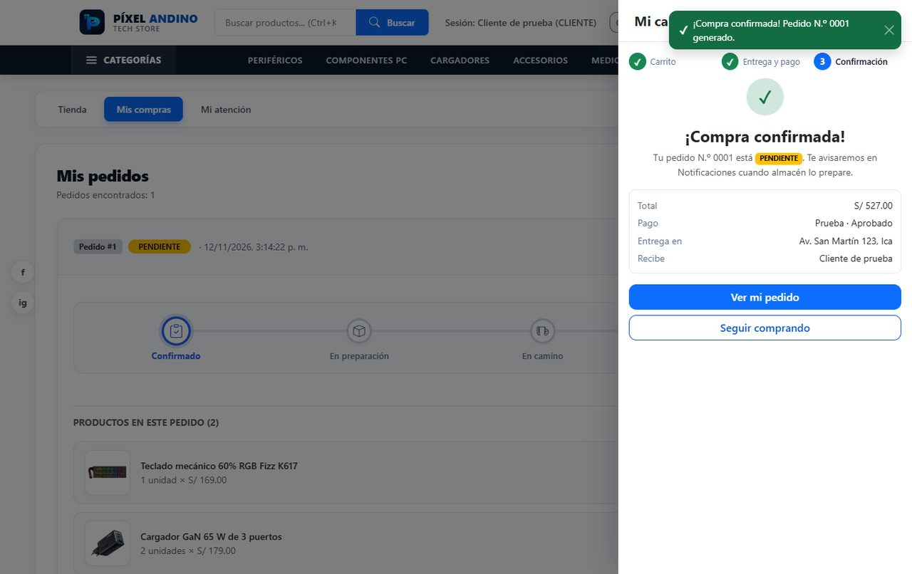
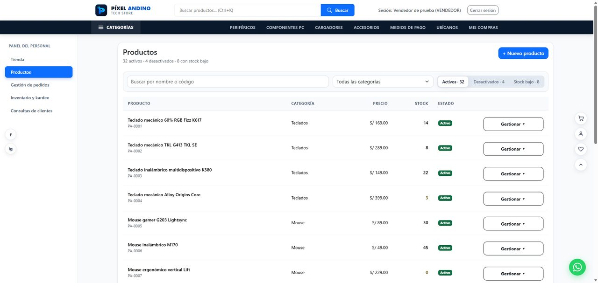
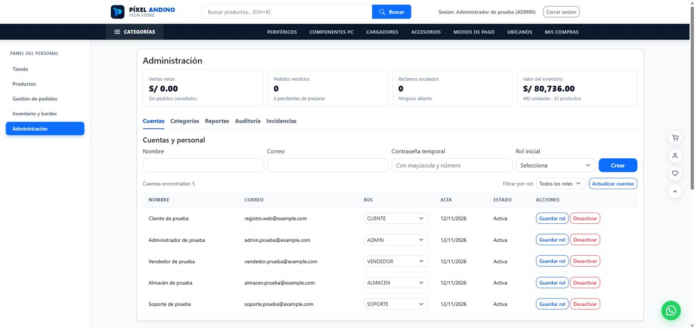
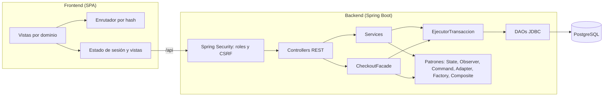

<div align="center">


# Píxel Andino

**Plataforma de comercio electrónico y gestión operativa para retail tecnológico.**


[Características](#características) ·
[Capturas](#capturas) ·
[Inicio rápido](#inicio-rápido) ·
[Arquitectura](#arquitectura) ·
[Patrones de diseño](#patrones-de-diseño) ·
[Pruebas](#pruebas)

</div>

---

## Descripción

Píxel Andino es una aplicación web full stack que cubre el flujo completo de una tienda de tecnología: catálogo, carrito, checkout, seguimiento de pedidos, atención postventa y operación interna por roles (ventas, almacén, soporte y administración).

Fue desarrollada como proyecto académico del curso **Diseño de Patrones de Software**, con el objetivo de aplicar patrones del catálogo GoF sobre un dominio realista, con un backend en capas y un frontend modular sin frameworks de UI.

> Los pagos son **simulados**: no se piden tarjetas ni se cobra dinero real.

## Características

### Tienda (cliente)

- **Inicio** con destacados, nuevos productos, ofertas, accesos «Compra por categoría» y el resumen del catálogo.
- **Catálogo** con filtros combinables (texto, categoría, rango de precios, solo en stock) y orden por precio o nombre.
- **Detalle de producto** con descuento («Ahorras S/ …»), stock disponible, consultas al vendedor y **productos relacionados** de la misma categoría.
- **Navegación SPA por hash** (`#/catalogo`, `#/categoria/:slug`, `#/producto/:sku`, `#/pedidos`) con historial del navegador y migas de pan.
- **Carrito híbrido:** el invitado usa `localStorage` y, al iniciar sesión, el carrito se sincroniza con PostgreSQL. Cada acción se puede **deshacer** (patrón Command).
- **Checkout en tres pasos** (Carrito → Entrega y pago → Confirmación): dirección de entrega, escenario de pago de prueba (aprobado o rechazado), resumen del pedido y pantalla de **compra confirmada**. Un pago rechazado no crea el pedido ni toca el carrito.
- **Mis compras:** avance del pedido por estados, filtros por estado con su conteo, transportista y código de seguimiento con botón **«Copiar código»**, y cancelación de pedidos pendientes.
- **Mi atención:** reclamos y devoluciones (con reembolso) sobre los pedidos entregados.
- **Registro** con reglas de contraseña que se marcan en vivo (8 a 72 caracteres, una mayúscula y un número; el backend aplica la misma regla) y aceptación de términos.
- **Notificaciones** en la aplicación cuando cambia el estado de un pedido.

### Panel del personal (RBAC)

En escritorio, el personal navega con un **menú lateral** fijo a la izquierda; en celular, con pestañas.

| Rol               | Capacidades                                                                                                                                                                                                 |
| :---------------- | :---------------------------------------------------------------------------------------------------------------------------------------------------------------------------------------------------------- |
| **Vendedor**      | Vista **Productos** (tabla con búsqueda, categoría y pestañas Activos / Desactivados / Stock bajo), **alta de productos** con vista previa, edición de ficha y precio, y respuesta a consultas de clientes. |
| **Almacén**       | Pedidos por preparar, despachar (transportista y código de seguimiento) y entregar; entradas de mercadería, ajustes de stock y kardex por producto y fecha.                                                 |
| **Soporte**       | Bandeja de reclamos y devoluciones con el contexto del pedido; reembolsos simulados.                                                                                                                       |
| **Administrador** | Indicadores generales, cuentas y roles del personal, árbol de categorías, reportes con exportación CSV, **auditoría** e incidencias escaladas.                                                                |

### Auditoría

El administrador consulta **quién hizo qué y cuándo**: inicios de sesión (también los fallidos y los bloqueados), altas de cuentas y cambios de rol, cambios de catálogo (alta, ficha, precio, stock, activación), categorías, reportes descargados y cambios de estado de pedidos, reclamos y devoluciones. Se filtra por fechas, acción y usuario, se pagina y se descarga en CSV.

## Capturas

| Tienda                                                       | Compra confirmada                                                          |
| :----------------------------------------------------------- | :------------------------------------------------------------------------- |
|   |     |
| **Panel del personal: Productos**                            | **Administración**                                                         |
|  |  |

## Stack tecnológico

| Capa                 | Tecnologías                                                                                     |
| :------------------- | :---------------------------------------------------------------------------------------------- |
| **Backend**          | Java 25, Spring Boot 4.1.2, Spring Security, JDBC (sin ORM), Flyway                             |
| **Base de datos**    | PostgreSQL 15+                                                                                  |
| **Frontend**         | HTML5, CSS3 (variables nativas), JavaScript con ES Modules, Bootstrap 5.3.9, Vite 8.3           |
| **Pruebas**          | JUnit 5, Mockito, Testcontainers (PostgreSQL real), JaCoCo; Node.js Test Runner y ESLint         |

## Inicio rápido

### Requisitos

- JDK 25
- Node.js 20+ y npm
- PostgreSQL 15+
- Docker (solo para las pruebas de integración)

### 1. Base de datos

Crea la base de datos vacía en PostgreSQL:

```sql
CREATE DATABASE retail_diseno_patrones;
```

No hace falta ejecutar scripts a mano: al iniciar el backend, **Flyway** aplica las migraciones versionadas de `backend/src/main/resources/db/migration`:

| Migración                                  | Contenido                                                                                                  |
| :----------------------------------------- | :--------------------------------------------------------------------------------------------------------- |
| `V1__esquema_base.sql`                     | Tablas, índices y restricciones `CHECK` (stock nunca negativo, estados válidos).                           |
| `V2__reclamos_devoluciones_y_revision.sql` | Reclamos, devoluciones, control optimista del carrito, fecha de entrega y unicidad del pago aprobado.      |
| `V3__notificacion_pedido_confirmado.sql`   | Notificación al confirmar un pedido.                                                                       |
| `V4__registro_auditoria.sql`               | Tabla `registro_auditoria` del módulo de auditoría.                                                        |

Con el perfil `dev` se cargan además los datos de demostración de `db/dev` (cuentas, 32 productos con fotos, categorías y un carrito de ejemplo).

> Los scripts manuales antiguos se conservan como referencia histórica en `database/legado/`.

### 2. Backend

Define las credenciales de la base de datos mediante variables de entorno:

| Variable      | Descripción                                                                 |
| :------------ | :-------------------------------------------------------------------------- |
| `DB_USER`     | Usuario de PostgreSQL (por ejemplo, `postgres`).                            |
| `DB_PASSWORD` | Contraseña del usuario. Es obligatoria: no hay valor por defecto.           |
| `DB_URL`      | Opcional. Por defecto, `jdbc:postgresql://localhost:5432/retail_diseno_patrones`. |

En despliegues con HTTPS define también `SESSION_COOKIE_SECURE=true`.

<details open>
<summary><b>Windows (PowerShell)</b></summary>

```powershell
$env:DB_USER = "postgres"
$env:DB_PASSWORD = "tu-contraseña-local"

cd backend
.\mvnw.cmd spring-boot:run -Dspring-boot.run.profiles=dev
```

</details>

<details>
<summary><b>Linux / macOS</b></summary>

```bash
export DB_USER="postgres"
export DB_PASSWORD="tu-contraseña-local"

cd backend
./mvnw spring-boot:run -Dspring-boot.run.profiles=dev
```

</details>

La API quedará disponible en `http://localhost:8081`.

### 3. Frontend

En otra terminal:

```bash
cd frontend
npm install
npm run dev
```

La aplicación se abrirá en `http://localhost:5173`. Vite redirige las peticiones a `/api` hacia el backend en el puerto 8081.

### Cuentas de demostración (perfil `dev`)

| Rol           | Correo                        |
| :------------ | :---------------------------- |
| Cliente       | `registro.web@example.com`    |
| Administrador | `admin.prueba@example.com`    |
| Vendedor      | `vendedor.prueba@example.com` |
| Almacén       | `almacen.prueba@example.com`  |
| Soporte       | `soporte.prueba@example.com`  |

Las contraseñas de estas cuentas están en `backend/src/main/resources/db/dev/V1000__datos_prueba.sql`.

## Arquitectura



El backend sigue una arquitectura en capas (controller → service → DAO) con **JDBC directo**: cada consulta usa `PreparedStatement` y las transacciones son explícitas. `EjecutorTransaccion` abre la transacción de cada caso de uso y presta la conexión a los DAO, que solo ejecutan SQL; así, una compra (pedido, detalle, stock, kardex, pago, historial y carrito) se guarda completa o no se guarda. Las filas que se modifican se bloquean con `SELECT ... FOR UPDATE` en orden ascendente de id.

El frontend está organizado por dominio funcional (catálogo, carrito, pedidos, inventario, administración…) y no depende de un framework de UI.

## Patrones de diseño

| Patrón             | Tipo           | Aplicación                                                                                                                                                                                                                       |
| :----------------- | :------------- | :------------------------------------------------------------------------------------------------------------------------------------------------------------------------------------------------------------------------------- |
| **Singleton**      | Creacional     | `ProveedorConexiones` es el punto único de acceso a las conexiones JDBC (componente de alcance singleton que envuelve el pool HikariCP).                                                                                           |
| **Factory Method** | Creacional     | `FabricaNotificador` crea el canal de aviso: `NotificadorInApp` (persistido en la base) o `NotificadorConsola`.                                                                                                                  |
| **Adapter**        | Estructural    | `PuertoPago` y `PagoPruebaAdapter` aíslan el checkout de la API del proveedor de pagos simulado.                                                                                                                                  |
| **Facade**         | Estructural    | `CheckoutFacade.confirmarCompra` es la única entrada a la compra: valida stock, descuenta inventario, registra el pago y emite el pedido en una transacción, con **clave de idempotencia** para que un reintento no duplique la compra. |
| **Composite**      | Estructural    | Árbol de categorías y subcategorías (`CategoriaComponente`, `ArbolCategoriaBuilder`), usado por el menú multinivel, los chips de categorías y las migas de pan.                                                                   |
| **State**          | Comportamental | Ciclo de vida del pedido (`PENDIENTE` → `EN_PREPARACION` → `DESPACHADO` → `ENTREGADO` / `CANCELADO`) en `patterns/state`; el frontend lo refleja en el avance de Mis compras.                                                     |
| **Observer**       | Comportamental | `PublicadorEventosPedido` avisa a sus observadores cuando cambia un estado: dentro de la transacción (notificación en la app y **registro de auditoría**) y después del commit (registro en consola y correo simulado).             |
| **Command**        | Comportamental | Cada acción del carrito (agregar, cambiar cantidad, quitar) es un `ComandoCarrito` con su `deshacer`; `HistorialComandosCarrito` permite deshacer la última.                                                                       |

## Seguridad

- **Autorización:** Spring Security valida el rol en cada petición (`CLIENTE`, `VENDEDOR`, `ALMACEN`, `SOPORTE`, `ADMIN`) y los servicios comprueban la propiedad del dato. El frontend solo oculta lo que no corresponde.
- **CSRF:** las peticiones que modifican datos llevan el token de la sesión; el cliente `api.js` lo obtiene y lo reintenta una vez si vence.
- **Inicio de sesión:** 5 intentos fallidos en 15 minutos bloquean el correo por 15 minutos (respuesta 429 con `Retry-After`), y el tiempo de respuesta no revela si la cuenta existe.
- **Contraseñas:** BCrypt; las cuentas nuevas exigen 8 a 72 caracteres, una mayúscula y un número.
- **XSS:** el texto entra al DOM con `textContent` o con la plantilla `html` que escapa los valores; las URL de imagen solo aceptan `http(s)` o rutas relativas.
- **Errores:** `GlobalExceptionHandler` responde `{"error": "..."}` sin trazas internas.
- **Sesión:** cookie `HttpOnly` y `SameSite=Lax`; `SESSION_COOKIE_SECURE=true` en HTTPS (el `Dockerfile` ya lo define).
- **Auditoría:** las acciones sensibles quedan registradas con fecha, usuario, rol y detalle.

## Pruebas

**Backend, pruebas unitarias** (JUnit 5 y Mockito, sin Docker):

```bash
cd backend
./mvnw clean test
```

**Backend, unitarias e integración** (Testcontainers levanta un PostgreSQL 15 efímero; requiere Docker). También genera el reporte de cobertura de JaCoCo en `backend/target/site/jacoco`:

```bash
cd backend
./mvnw clean verify
```

> Las pruebas nunca usan tu base local: si una prueba de Spring intentara conectarse sin Testcontainers, falla a propósito.

**Frontend** (Node.js Test Runner y ESLint):

```bash
cd frontend
npm test
npm run lint
```

**Build de producción:**

```bash
cd frontend
npm run build
```

## Estructura del proyecto

```text
retail/
├── backend/
│   └── src/
│       ├── main/java/com/grupo/retail/
│       │   ├── controller/    # Endpoints REST
│       │   ├── service/       # Reglas de negocio
│       │   ├── facade/        # CheckoutFacade
│       │   ├── transaccion/   # EjecutorTransaccion
│       │   ├── dao/           # Acceso a datos con JDBC
│       │   ├── patterns/      # command, composite, factory, observer, pago, singleton, state
│       │   ├── security/      # Sesión, límite de intentos y manejo de errores de seguridad
│       │   ├── config/        # Spring Security y configuración
│       │   ├── reportes/      # Escritura de CSV
│       │   ├── model/  dto/   # Dominio y objetos de transferencia
│       │   └── exception/     # Manejo global de errores
│       ├── main/resources/db/ # migration (Flyway) y dev (datos de demostración)
│       └── test/java/         # Unitarias e integración (integracion/)
├── frontend/
│   ├── src/
│   │   ├── catalogo/  carrito/  pedidos/  atencion/  soporte/
│   │   ├── inventario/  administracion/  vendedor/  notificaciones/
│   │   ├── autenticacion/  api/  estado/  router/  modales/  utilidades/
│   │   ├── layout/            # Componentes y plantillas HTML
│   │   ├── css/               # Estilos por dominio
│   │   └── main.js            # Punto de entrada
│   └── test/                  # Pruebas del frontend
├── database/                  # Scripts SQL anteriores a Flyway (referencia histórica)
└── docs/img/                  # Logo y capturas del README
```
