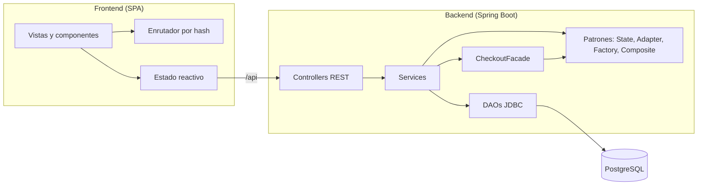

<div align="center">


# Píxel Andino

**Plataforma de comercio electrónico y gestión operativa para retail tecnológico.**


[Características](#características) ·
[Capturas](#capturas) ·
[Inicio rápido](#inicio-rápido) ·
[Arquitectura](#arquitectura) ·
[Patrones de diseño](#patrones-de-diseño) ·
[Pruebas](#pruebas)

</div>

---

## Descripción

Píxel Andino es una aplicación web full stack que cubre el flujo completo de una tienda de tecnología: catálogo, carrito, checkout, seguimiento de pedidos y operación interna por roles (ventas, almacén y administración).

Fue desarrollada como proyecto académico del curso **Diseño de Patrones de Software** , con el objetivo de aplicar patrones del catálogo GoF sobre un dominio realista, con un backend en capas y un frontend modular sin frameworks de UI.

## Capturas

<!--
Guarda tus capturas de pantalla en docs/img/ (catalogo.png, checkout.png, pedidos.png, admin.png)
y descomenta esta tabla para visualizarlas en GitHub:

|        Vitrina del catálogo        |              Checkout              |
| :--------------------------------: | :--------------------------------: |
|  |  |

|      Seguimiento de pedidos      |        Panel de administración        |
| :------------------------------: | :-----------------------------------: |
|  |  |
-->

> [!NOTE]
> Las capturas visuales de la interfaz (`catalogo.png`, `checkout.png`, `pedidos.png`, `admin.png`) se configuran en el directorio [`docs/img/`](docs/img/).

## Características

### Tienda (cliente)

- **Catálogo interactivo** con productos destacados, indicadores de stock y cálculo de ahorro porcentual.
- **Filtros combinables** por texto, categoría, rango de precios y orden (precio, nombre A-Z), con _debounce_ en la búsqueda.
- **Navegación SPA por hash** (`#/catalogo`, `#/categoria/:slug`, `#/producto/:sku`, `#/pedidos`) con historial del navegador, títulos dinámicos y migas de pan accesibles.
- **Carrito híbrido:** los invitados usan `localStorage`, y al iniciar sesión o registrarse el carrito se sincroniza con PostgreSQL de forma atómica.
- **Seguimiento de pedidos** con indicador visual de estado, datos del transportista y cancelación de pedidos pendientes.
- **Consultas al vendedor** mediante un formulario modal por producto.

### Operación interna (RBAC)

| Rol               | Capacidades                                                                                                                                        |
| :---------------- | :------------------------------------------------------------------------------------------------------------------------------------------------- |
| **Vendedor**      | Bandeja de consultas asignadas y respuesta a clientes.                                                                                             |
| **Almacén**       | Pedidos pendientes de despacho, asignación de transportista y código de seguimiento, entradas de mercadería (Kardex) y ajuste de stock.            |
| **Administrador** | Gestión de personal y roles, activación/desactivación de cuentas, administración del árbol de categorías y reportes de ventas con exportación CSV. |
| **Soporte**       | Cuenta de atención sembrada en la base de datos.                                                                                                   |

Las notificaciones in-app muestran un contador de alertas no leídas y pausan el sondeo en pestañas inactivas mediante la Page Visibility API.

## Stack tecnológico

| Capa                 | Tecnologías                                                                                   |
| :------------------- | :-------------------------------------------------------------------------------------------- |
| **Backend**          | Java 25, Spring Boot 4.1.2, JDBC, JUnit 5, Mockito                                            |
| **Base de datos**    | PostgreSQL 15+                                                                                |
| **Frontend**         | HTML5, CSS3 (BEM y variables nativas), JavaScript con ES Modules, Bootstrap 5.3.8, Vite 8.3.3 |
| **Pruebas frontend** | Node.js Test Runner                                                                           |

## Inicio rápido

### Requisitos

- JDK 25 (compatible con JDK 21+)
- Node.js 20+ y npm
- PostgreSQL 15+

### 1. Base de datos

Crea la base de datos:

```sql
CREATE DATABASE retail_diseno_patrones;
```

Ejecuta los scripts de la carpeta `database/` en este orden:

| Script                             | Contenido                                                                  |
| :--------------------------------- | :------------------------------------------------------------------------- |
| `00_esquema_base.sql`              | Estructura DDL completa: tablas, índices, roles y restricciones.           |
| `02_datos_prueba.sql`              | Cuentas de los 5 roles con hash BCrypt y carrito inicial de prueba.        |
| `11_datos_demo_pixel_andino.sql`   | Catálogo oficial: los 32 productos tecnológicos con stock e inventario.    |
| `12_perifericos_subcategorias.sql` | Jerarquía del patrón Composite: subcategorías vinculadas para Periféricos. |

### 2. Backend

Define las credenciales de la base de datos:

| Variable      | Descripción                                      |
| :------------ | :----------------------------------------------- |
| `DB_USER`     | Usuario de PostgreSQL (por ejemplo, `postgres`). |
| `DB_PASSWORD` | Contraseña del usuario.                          |

En despliegues con HTTPS define también `SESSION_COOKIE_SECURE=true`.

<details>
<summary><b>Windows (PowerShell)</b></summary>

```powershell
$env:DB_USER = "postgres"
$env:DB_PASSWORD = "tu-contraseña-local"

cd backend
.\mvnw.cmd spring-boot:run
```

</details>

<details>
<summary><b>Linux / macOS</b></summary>

```bash
export DB_USER="postgres"
export DB_PASSWORD="tu-contraseña-local"

cd backend
./mvnw spring-boot:run
```

</details>

La API quedará disponible en `http://localhost:8081`.

### 3. Frontend

En otra terminal:

```bash
cd frontend
npm install
npm run dev
```

La aplicación se abrirá en `http://localhost:5173`. Vite redirige las peticiones a `/api` hacia el backend en el puerto 8081.

### Cuentas de demostración

> [!WARNING]
> Estas credenciales son solo para desarrollo local. No las uses en un entorno real.

Todas las cuentas comparten la contraseña `PixelAndino2026!`.

| Rol           | Correo                        |
| :------------ | :---------------------------- |
| Cliente       | `registro.web@example.com`    |
| Administrador | `admin.prueba@example.com`    |
| Vendedor      | `vendedor.prueba@example.com` |
| Almacén       | `almacen.prueba@example.com`  |
| Soporte       | `soporte.prueba@example.com`  |

## Arquitectura



El backend sigue una arquitectura en capas (controller, service, DAO) con acceso a datos mediante JDBC directo, lo que mantiene explícitas las consultas y las transacciones. El frontend está organizado por dominio funcional y no depende de un framework de UI.

## Patrones de diseño

| Patrón                   | Tipo           | Aplicación                                                                                                                                                                                                              |
| :----------------------- | :------------- | :---------------------------------------------------------------------------------------------------------------------------------------------------------------------------------------------------------------------- |
| **State**                | Comportamental | Ciclo de vida del pedido (`PENDIENTE` → `EN_PREPARACION` → `DESPACHADO` → `ENTREGADO` / `CANCELADO`) con transiciones válidas encapsuladas en `patterns/state`. El frontend lo refleja en `pedidos/pedidos-stepper.js`. |
| **Composite**            | Estructural    | Árbol recursivo de categorías y subcategorías (`ArbolCategoriaBuilder`, `CategoriaDAO`), consumido por el menú multinivel y las migas de pan (`router/enrutador.js`).                                                   |
| **Adapter**              | Estructural    | Integración con la pasarela de pago simulada mediante `PuertoPago` y `PagoPruebaAdapter`, que aísla la lógica de negocio de la API del proveedor.                                                                  |
| **Facade**               | Estructural    | `CheckoutFacade` orquesta de forma transaccional la validación de stock, la reserva, el pago y la emisión del pedido.                                                                                                   |
| **Factory Method**       | Creacional     | `FabricaNotificador` crea el canal de notificación: `NotificadorInApp` (persistencia en BD) o `NotificadorConsola` (logging).                                                                                           |
| **Singleton**            | Creacional     | `ProveedorConexiones` es el punto único de acceso a las conexiones JDBC: un componente de alcance singleton de Spring que delega en el pool (`DataSource`).                                                                                                                                                            |
| **Inversión de control** | Arquitectural  | En el frontend, los modales de Bootstrap, el cliente `apiRequest` y el estado global se inyectan en los componentes, lo que permite probarlos de forma aislada en Node.js.                                              |

## Seguridad

- **XSS:** utilidades centralizadas de sanitización (`escaparHtml` y _template tag_ `html`) y manipulación segura del DOM (`textContent`, `replaceChildren`).
- **Contraseñas:** almacenadas con hash BCrypt.
- **Errores:** `GlobalExceptionHandler` responde con un JSON `{"error": "..."}` y no expone trazas internas. Los fallos de acceso a datos (`ErrorAccesoDatosException`) se registran en el log y se responden como 500 genérico.
- **Sesión:** cookie `HttpOnly` y `SameSite=Lax`. Define `SESSION_COOKIE_SECURE=true` cuando el despliegue use HTTPS (el `Dockerfile` ya lo hace).
- **Pagos idempotentes:** cada checkout usa una clave `UUID` única para evitar cargos duplicados.
- **Control de acceso:** autorización por roles (`CLIENTE`, `ADMIN`, `VENDEDOR`, `ALMACEN`, `SOPORTE`).

## Pruebas

**Backend** (JUnit 5 y Mockito):

```bash
cd backend
./mvnw clean test
```

**Frontend** (Node.js Test Runner):

```bash
cd frontend
npm test
```

**Build de producción:**

```bash
cd frontend
npm run build
```

## Estructura del proyecto

```text
retail/
├── backend/
│   └── src/
│       ├── main/java/com/grupo/retail/
│       │   ├── controller/   # Endpoints REST
│       │   ├── service/      # Lógica de negocio y transacciones
│       │   ├── dao/          # Acceso a datos con JDBC
│       │   ├── facade/       # CheckoutFacade
│       │   ├── patterns/     # State, Adapter, Factory, Composite
│       │   ├── model/        # Entidades de dominio
│       │   ├── dto/          # Objetos de transferencia
│       │   └── exception/    # Manejo global de errores
│       └── test/java/        # Pruebas unitarias e integración
├── frontend/
│   ├── src/
│   │   ├── administracion/  autenticacion/  carrito/  catalogo/
│   │   ├── inventario/      notificaciones/ pedidos/   vendedor/
│   │   ├── estado/          router/         modales/   utilidades/
│   │   ├── layout/          # Componentes y plantillas HTML
│   │   ├── css/             # Estilos modulares por dominio
│   │   └── main.js          # Punto de entrada
│   └── test/                # Pruebas unitarias
└── database/                # Scripts DDL y DML para PostgreSQL
```

## Roadmap

- [ ] Documentación de la API con OpenAPI/Swagger.
- [ ] Integración con una pasarela de pago real.
- [ ] Autenticación basada en tokens (JWT).
- [ ] Integración continua con GitHub Actions.
- [ ] Despliegue con Docker Compose.

## Autores

- `<Nombre>` — [@makaay_atr](https://github.com/AnthonyLitz75)

## Licencia

Distribuido bajo la licencia MIT. Consulta el archivo [`LICENSE`](LICENSE) para más información.
